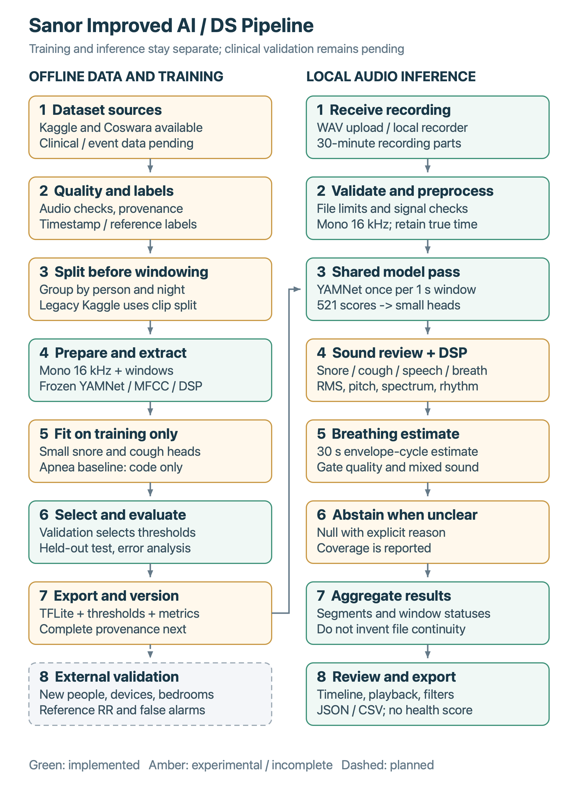
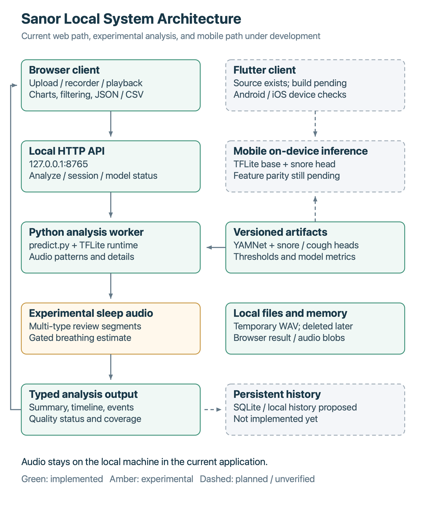

# รายงานขอบเขตและความคืบหน้าโครงการ Sanor

ข้อมูล ณ วันที่ 16 ตุลาคม 2026

Sanor เป็นระบบวิเคราะห์เสียงระหว่างนอนที่ประมวลผลในเครื่อง เป้าหมายคือช่วยให้ผู้ใช้เห็นรูปแบบเสียงกรนและเสียงอื่นตลอดคืน เปรียบเทียบการเปลี่ยนแปลง และย้อนฟังช่วงที่ระบบคัดไว้ได้ รายงานนี้สรุปงานเดิม เป้าหมายเพิ่มเติม การเตรียมข้อมูล โมเดล ผลฝึกจริง ความคืบหน้า และแบบระบบที่ใช้พัฒนาต่อ

## 1 รีแคปและลำดับความสำคัญของฟีเจอร์

### งานเดิมที่มีแล้ว

ระบบ Python และเว็บรับ WAV หรืองานบันทึกเสียง แล้วตรวจกรนด้วย YAMNet และหัวจำแนกที่ฝึกเอง แสดงเวลาที่พบกรน สัดส่วน จำนวนช่วง ความดัง RMS และ dBFS ความถี่เด่น Pitch Spectrogram จังหวะเสียง ช่วงเงียบ และความดังที่กลับมาหลังช่วงเงียบ มี Timeline การเลือกช่วงฟัง เปรียบเทียบหลายไฟล์ และส่งออก JSON/CSV

เว็บแบ่งการบันทึกเป็นไฟล์ละ 30 นาที ผลหลายไฟล์รวมตามเวลาที่บันทึกจริงได้ โดยไม่สร้างเหตุการณ์ข้ามรอยต่อที่ยังไม่ยืนยันว่าต่อเนื่องกัน มีตัวอย่างจำลอง 8 ชั่วโมงสำหรับตรวจหน้าจอ แต่ยังไม่ใช่ผลทดสอบการอัดและวิเคราะห์เสียงจริง 8 ชั่วโมง

### เป้าหมายเพิ่มเติมที่กำลังทำ

เพิ่ม Timeline หลายประเภทเสียง ได้แก่ กรน เสียงคล้ายไอ เสียงพูด และเสียงคล้ายหายใจ พร้อมตัวกรองและการย้อนฟัง เพิ่มการประมาณรอบการหายใจจากเสียงในหน้าต่าง 30 วินาทีเฉพาะช่วงที่ผ่านเงื่อนไข และแสดงเหตุผลเมื่อประมาณไม่ได้

### ลำดับฟีเจอร์จากสำคัญที่สุด

1. **ตรวจกรนและติดตามปริมาณ** — เป็นความสามารถหลัก ต้องรักษานิยามเวลาและทดสอบกับเสียงที่ไม่ได้ใช้ฝึก
2. **Timeline พร้อมหลักฐานเสียง** — ให้ผู้ใช้ตรวจสิ่งที่โมเดลรายงาน แยกประเภทเสียงและเลือกฟังแต่ละช่วงได้
3. **ตรวจคุณภาพข้อมูลและงดให้ค่าที่ไม่พอ** — แยกเสียงเงียบ เสียงแตก เสียงปะปน และข้อมูลไม่ครบออกจากผลที่ใช้ได้
4. **ความดัง ความถี่ และจังหวะ** — อธิบายลักษณะเสียงและการเปลี่ยนแปลง พร้อมกราฟประกอบ
5. **ประมาณอัตราหายใจจากเสียง** — เป็นฟีเจอร์ทดลอง ต้องมีเสียงคล้ายหายใจและรูปแบบซ้ำชัด ไม่แปลงระยะห่างการกรนเป็นลมหายใจโดยตรง
6. **เปรียบเทียบหลายคืนและประวัติถาวร** — ปัจจุบันเปรียบเทียบหลายไฟล์ในแท็บเดียวได้ ส่วนประวัติที่เปิดดูภายหลังยังต้องพัฒนา
7. **แอปมือถือและการอัดต่อเนื่อง** — มีซอร์ส Flutter แต่ยังต้อง build และทดสอบอุปกรณ์จริง รวมล็อกจอ สายเข้า แบตเตอรี่ และการคืนสิทธิ์ไมโครโฟน

ฟีเจอร์ OSA, Gasping, Wheezing, กัดฟัน และการประมาณระยะการหลับเป็นงานวิจัยระยะถัดไป แบบสอบถามยังเลื่อนไว้ตามขอบเขตที่ตกลงกัน เป้าหมายปัจจุบันไม่รวมคะแนนสุขภาพหรือเปอร์เซ็นต์ความเสี่ยงโรค

## 2 ขั้นตอนการเตรียมข้อมูล

### 2.1 กำหนดหน่วยข้อมูลและป้ายก่อนฝึก

แยกป้ายประเภทคลิปออกจากป้ายเหตุการณ์ตามเวลา โมเดลกรนเดิมฝึกจากคลิปสั้น ส่วน Timeline หลายเสียงต้องมีเวลาเริ่มและจบของแต่ละประเภท การตรวจว่าคลิปเป็นเสียงไอไม่ได้บอกจำนวนครั้งที่ไอภายในคลิป และป้ายเสียงพูดไม่ได้ยืนยันว่าเจ้าของเสียงกำลังละเมอ

ตารางข้อมูลสำหรับงานเพิ่มเติมควรมี recording_id, person_id, night_id, device_id, audio_path, start_seconds, end_seconds, label, annotator_id, label_source, quality และ split โดยอนุญาตหลายป้ายซ้อนกันเมื่อมีหลายเสียงพร้อมกัน ข้อมูลระบุตัวบุคคลใช้รหัสแทนชื่อ

### 2.2 รวบรวมข้อมูลและบันทึกแหล่งที่มา

- **กรน** — ใช้ Kaggle Snoring ที่แบ่งกรนและไม่กรนเป็นชุดตั้งต้น มีข้อมูลใช้งานหลังกรองซ้ำ 991 คลิป
- **ไอ** — ใช้ Coswara ส่วนที่มีอยู่จาก 32 คน รวม 186 ไฟล์ที่ผ่านเกณฑ์คุณภาพ มีทั้งไอ หายใจ และการนับเลข
- **หลายประเภทเสียง** — สำรวจ DreamCatcher ซึ่งมีป้ายเสียงหลายชนิดและโค้ดต้นแบบ แต่ยังไม่ได้ดาวน์โหลดหรือฝึกโมเดลในโครงการ ชุดนี้บันทึกจากอุปกรณ์ที่หู จึงต้องประเมินความต่างจากโทรศัพท์ข้างเตียง
- **อัตราหายใจและเหตุการณ์ทางการหายใจ** — ต้องมีเสียงที่บันทึกพร้อมข้อมูลอ้างอิง เช่น สายรัดหายใจหรือลมเข้าออก และตรวจเวลาให้ตรงกัน PSG-Audio เป็นแหล่งที่สำรวจไว้ แต่ยังไม่ได้เตรียมข้อมูลจริงเข้าฝึก

### 2.3 ตรวจคุณภาพและจัดรูปแบบเสียง

อ่านชนิดไฟล์จริง ตรวจไฟล์เสีย เสียงว่าง ระยะเวลา sample rate และจำนวนช่องเสียง จากนั้นแปลงเป็น mono 16 kHz สำหรับโมเดลปัจจุบัน เก็บไฟล์ต้นฉบับแยกจากไฟล์แปลง ตรวจค่าไม่เป็นจำนวน เสียงแตก และขนาดไฟล์ พร้อมบันทึกเวอร์ชัน preprocessing ไม่ปรับ gain หรือทำ noise reduction โดยไม่ทดสอบว่าทำให้ข้อมูลสำคัญเปลี่ยนหรือไม่

สำหรับ Kaggle ระบบแปลงคลิปเป็นช่วง 1 วินาทีและตรวจข้อมูลซ้ำด้วย hash ของ waveform สำหรับ Coswara เลือกไฟล์คุณภาพ good/excellent แล้วใช้หน้าต่าง 1 วินาทีที่ RMS สูงที่สุดต่อไฟล์ วิธีนี้เหมาะกับ baseline จำแนกคลิป แต่ยังไม่ครอบคลุมเสียงไอสั้นทุกเหตุการณ์ในคืนจริง

### 2.4 แบ่งชุดข้อมูลก่อนตัดหน้าต่าง

งานใหม่แบ่ง train, validation และ test ตามคนและคืนก่อนสร้างคลิป เพื่อไม่ให้เสียงของคนหรือคืนเดียวกันรั่วข้ามชุด ตรวจ waveform ซ้ำข้ามชุด และเก็บชุดทดสอบห้องนอนจริงแยกไว้

ข้อจำกัดของโมเดลกรนเดิมคือ Kaggle ไม่มีรหัสคนและแหล่งอัดเพียงพอ จึงใช้การสุ่มแบ่งคลิป 693/149/149 แม้ตรวจข้อมูลซ้ำแบบตรงกันแล้วก็ยังอาจมีความคล้ายจากแหล่งเดียวกันข้ามชุด ส่วน Coswara แบ่งตามคนเป็น 104/40/42 ไฟล์แล้ว

### 2.5 เตรียมข้อมูลอ้างอิงและป้ายเหตุการณ์

สำหรับงานวิจัย apnea ต้องแปลง ambient microphone จาก EDF เป็น WAV และแปลงป้าย RML เป็น CSV โดยตรวจ offset และ synchronization ให้ตรงกับเสียง ระบบยังไม่มีตัวนำเข้า EDF/RML อัตโนมัติ

เครื่องมือ prepare_apnea.py ใช้หน้าต่างเต็ม 30 วินาที เฉพาะช่วงที่ยืนยันว่ามีการให้คะแนนการหลับครบ ตัดช่วง artifact ออก ให้ป้ายบวกเมื่อมี event overlap รวมอย่างน้อย 10 วินาที ให้ป้ายลบเมื่อไม่มี overlap และตัดหน้าต่างกำกวมที่ overlap มากกว่า 0 แต่น้อยกว่า 10 วินาทีออก เป้าหมายนี้เป็นการจำแนกหน้าต่างที่มีเหตุการณ์ ไม่ใช่การวินิจฉัย OSA รายบุคคล

### 2.6 จัดเก็บชุดข้อมูลที่ตรวจสอบซ้ำได้

จัดทำ manifest ระบุแหล่งข้อมูล สิทธิ์ใช้งาน เวอร์ชัน checksum ป้าย และ split พร้อมเก็บรายการไฟล์ที่ถูกตัดออกและเหตุผล ชุดข้อมูลจำลองต้องติดป้าย SYNTHETIC ชัดเจนและห้ามนำผลทดสอบจำลองไปอ้างเป็นความแม่นยำในคนจริง

## 3 โมเดลและอัลกอริทึมที่ต้องใช้

### 3.1 โมเดลที่ใช้งานแล้ว

**YAMNet แบบ pretrained และ frozen** ใช้เป็นตัวสกัดคุณลักษณะร่วม โมเดล TFLite ที่ระบบใช้อยู่ส่งออกคะแนนคลาส 521 ค่า แล้วส่งชุดคะแนนเดียวกันไปยังหัวจำแนกกรนและไอ การเรียก base เพียงครั้งเดียวต่อหน้าต่างช่วยลดการคำนวณซ้ำ

**หัวจำแนกกรนและไอ** ใช้ neural network ขนาดเล็ก Dense 64 หน่วยพร้อม ReLU, Dropout 0.2 และ Dense 1 หน่วยพร้อม Sigmoid โดยไม่ได้ฝึก YAMNet ใหม่ทั้งตัว

### 3.2 วิธีที่ใช้คำนวณเสียงโดยไม่ต้องฝึกโมเดล

- RMS และ dBFS สำหรับขนาดสัญญาณและระดับเสียงสัมพัทธ์
- FFT และ Hann window สำหรับความถี่เด่นและ spectral centroid
- Spectrogram สำหรับการกระจายพลังงานตามเวลาและความถี่
- Normalized autocorrelation สำหรับ Pitch/F0 และรูปแบบความดังที่เกิดซ้ำ
- ช่วงเริ่มกรน ระยะห่าง ส่วนเบี่ยงเบนมาตรฐาน และ CV สำหรับความสม่ำเสมอของกลุ่มผลตรวจ
- กฎช่วงเงียบและความดังก่อน–หลังสำหรับคัดช่วงกลับไปฟัง

อัลกอริทึมเหล่านี้ไม่ได้ฝึกด้วย label การตั้ง threshold เป็นพารามิเตอร์ทางวิศวกรรม จึงต้องทดสอบกับข้อมูลจริงก่อนตีความเป็นอาการ

### 3.3 รุ่นทดลองสำหรับเสียงหลายประเภท

นำคะแนน YAMNet Speech index 0 และ Breathing index 36 มาใช้คัดช่วงเสียง ร่วมกับหัวจำแนกกรนและไอเดิม ค่าเริ่มต้นคะแนน YAMNet 0.5 เป็นเกณฑ์ทดลอง ยังไม่ได้เลือกจากชุด validation เสียงข้างเตียง ผลจึงระบุว่าเป็น review segment และอนุญาตหลายประเภทซ้อนทับกัน

ระบบยังไม่มีโมเดลกัดฟัน การขยับตัว หรือการละเมอที่ฝึกเอง การพัฒนาถัดไปควรเปรียบเทียบ YAMNet transfer learning กับ Audio Spectrogram Transformer หรือ Wav2Vec2 ตามข้อมูลที่เข้าถึงได้ โดยใช้ baseline ที่ง่ายก่อนและวัดผลแยกตามคน อุปกรณ์ และชนิดเสียง

### 3.4 รุ่นทดลองสำหรับอัตราหายใจ

ใช้หน้าต่าง 30 วินาที ตรวจเสียงแตกและระดับสัญญาณ ต้องมีเสียงคล้ายหายใจอย่างน้อย 50% และจำกัดเสียงพูด/ไอและกรนที่ปะปน จากนั้นลด sample rate เพื่อคำนวณ กรองย่านเสียง สร้าง RMS envelope ประมาณ 10 Hz แล้ววัดคาบด้วย autocorrelation ตรวจความสอดคล้องกับระยะห่างจุดยอดอีกครั้ง

ตัวประมาณค้นหาช่วง 6–30 รอบต่อนาที มีเงื่อนไขความสัมพันธ์อย่างน้อย 0.65 และ CV ไม่เกิน 0.25 ช่วงนี้เป็นข้อจำกัดของต้นแบบ ไม่ใช่เกณฑ์ตัดสินความปกติทางสุขภาพ หากข้อมูลไม่พอให้คืน null พร้อมเหตุผล เช่น เสียงเบา เสียงปะปน ไม่มีคาบชัด หรือช่วงสั้นเกินไป ตัวประมาณยังอาจถูกหลอกจากเสียงเครื่องจักรที่เป็นจังหวะ จึงต้องตรวจสอบกับข้อมูลการหายใจอ้างอิง

การประเมินควรรายงาน MAE หน่วยครั้งต่อนาที ความคลาดเคลื่อนรายหน้าต่าง Bland–Altman และ coverage ควบคู่กัน เพื่อไม่ให้ระบบดูแม่นเพราะเลือกให้ค่าเฉพาะบางช่วงโดยไม่บอกเวลาที่ปฏิเสธผล

### 3.5 งานวิจัยที่เตรียม pipeline ไว้แต่ยังไม่ฝึกจริง

Apnea baseline ใช้ MFCC 13 ตัว สรุป mean/std ร่วมกับ log-RMS และ zero-crossing รายวินาที แล้วใช้ StandardScaler กับ Logistic Regression แบบถ่วงน้ำหนักตามคน เลือก threshold จาก validation balanced accuracy มีโค้ดแล้ว แต่ยังไม่มีโมเดลจากข้อมูล apnea จริง

Sleep staging ด้วย HuBERT และการทำนายท่านอนด้วยเสียงเป็นทางเลือกที่สำรวจไว้ ยังไม่ได้เลือกเป็นองค์ประกอบของเวอร์ชันนี้ และยังไม่มีผลฝึกของโครงการ

### 3.6 คะแนนเสียงกรนรวมและเกณฑ์การคำนวณ

#### นิยามและสูตรคะแนนรวม

อัปเดต 16 ตุลาคม 2026 — เว็บแสดงคะแนนเสียงกรนรวมเต็ม 100 เป็นค่าหลัก พร้อมรายละเอียดแต่ละส่วนที่กดเปิดดูได้ คะแนนสูงหมายถึงผลตรวจมีสัดส่วนเวลากรนและสัดส่วนช่วงห่างเข้าเงื่อนไขน้อยลงตามสูตร ไม่ได้ยืนยันว่าหลับดีหรือไม่มีความเสี่ยงโรค

กำหนด D = เวลาที่ตรวจพบกรน ÷ เวลาบันทึกทั้งหมด, N = จำนวนระยะห่างที่เข้าเงื่อนไข, M = จำนวนระยะห่างระหว่างจุดเริ่มช่วงกรนที่ต่อเนื่องกันทั้งหมด และ P = N ÷ M

ระยะห่างเข้าเงื่อนไขเมื่อมากกว่า 10 แต่น้อยกว่า 100 วินาที โดยวัดจากจุดเริ่มช่วงกรนหนึ่งถึงจุดเริ่มช่วงถัดไป ไม่ใช่ระยะเงียบอย่างเดียว; เท่ากับ 10 หรือ 100 วินาทีไม่นับ

คะแนนเวลา = 100 × (1 − D)

คะแนนช่วงห่าง = 100 × (1 − P)

คะแนนรวม = 0.5 × คะแนนเวลา + 0.5 × คะแนนช่วงห่าง = 100 − 50D − 50P

น้ำหนักเวลากรน 50% และช่วงห่าง 50% เป็นทางเลือกของโครงการ คำนวณจากค่าดิบก่อนปัดคะแนนรวมเป็นทศนิยม 1 ตำแหน่ง ไม่รวมความดัง Pitch หรือ CV ในสูตรรุ่นนี้

#### ตัวอย่างการคำนวณและการแสดงผล

ตัวอย่างสมมติ: พบกรน 25% ของเวลาบันทึก จึงได้คะแนนเวลา 75; มีระยะห่างเข้าเงื่อนไข 2 จาก 4 ช่วง จึงได้คะแนนช่วงห่าง 50; คะแนนรวม = 75 × 0.5 + 50 × 0.5 = 62.5/100 หรือเริ่ม 100 หักด้านเวลา 12.5 และด้านช่วงห่าง 25 คะแนน

ตัวอย่างจำลอง 8 ชั่วโมงบนเว็บ: พบกรน 36.6667%, มีช่วงห่างเข้าเงื่อนไข 480 จาก 4,799 ช่วง ได้คะแนนรวม 76.7/100 ภาพนี้เป็นข้อมูลสังเคราะห์สำหรับตรวจการคำนวณและหน้าจอ ไม่ใช่ผลวิเคราะห์บุคคลจริง

หากข้อมูลหมวดใดไม่ครบหรือไม่ถูกต้อง หรือมีช่วงกรนน้อยกว่า 2 ช่วง ระบบแสดง “ข้อมูลไม่พอให้คะแนนรวม” และคืน null ไม่แทนด้วย 0 หรือ 100 และไม่ปรับน้ำหนักหมวดที่เหลือขึ้นมาแทน

#### หลักฐานที่รองรับและขอบเขต

งานวิจัยใช้สัดส่วนเวลาที่กรนเป็นตัวชี้วัดเสียง แต่ไม่ได้รับรองสูตร 100 ลบเปอร์เซ็นต์ของโครงการ งาน STII กำหนดการนับระยะห่าง 10–100 วินาทีต่อชั่วโมงหลับในผู้ป่วย 17 คน; สูตรแปลงสัดส่วนช่วงห่างเป็นคะแนน 0–100 และการรวม 50/50 ของ Sanor ยังไม่ได้ผ่านการตรวจสอบความตรงทางคลินิก

ระบบแสดง STII ดัดแปลง = N ÷ ชั่วโมงบันทึก เพื่อให้ตรวจสอบค่าดิบได้ งานต้นฉบับใช้ชั่วโมงหลับจริง ส่วนระบบใช้กลุ่มช่วงเสียงที่โมเดลตรวจพบ จึงอาจรวมกรนหลายครั้งเป็นช่วงเดียว ค่านี้ไม่ใช่ AHI

คะแนนช่วงห่างสูงบอกเพียงว่ามีสัดส่วนช่วงที่เข้าเงื่อนไขน้อย ไม่ได้วัดความสม่ำเสมอทั้งหมด เช่น ระยะห่างเกิน 100 วินาทีไม่เข้าเงื่อนไขนี้ ผลยังขึ้นกับเสียงรบกวน การแบ่งช่วง และความถูกต้องของโมเดล ไม่จัดระดับสุขภาพหรือความเสี่ยง OSA

#### สถานะ PSS และการส่งออก

PSS มีสูตรวิจัย 28.5 × ln(N₅/sone) + 11.3 × ln(Rmean/asper) − 23.9 ใช้ความดังตามการรับรู้ในช่วงเสียงดังที่สุด 5% และความหยาบของเสียงเฉลี่ย ค่า RMS/dBFS หรือ P95 ของ RMS ปัจจุบันใช้แทนไม่ได้ ต้องเพิ่มการวัด psychoacoustics และสอบเทียบเสียงก่อน

PSS จึงยังเป็น null และไม่นับรวม ไม่ถือเป็น 0 คะแนน สูตร PSS ไม่ได้มีช่วง 0–100 โดยอัตโนมัติ หากเพิ่มภายหลังต้องกำหนดและตรวจสอบวิธีแปลงค่าและน้ำหนักใหม่อย่างชัดเจน

JSON ส่งออก audio_scores.combined พร้อม score, maximum, version, weights, formula และ excluded_categories; CSV เพิ่ม combined_snore_score และ combined_snore_score_version ขณะที่ snore_duration_score เดิมยังหมายถึงคะแนนด้านเวลา

#### เอกสารอ้างอิง

[สัดส่วนเวลาที่กรน — Accuracy of a Smartphone Application Measuring Snoring in Adults](https://pmc.ncbi.nlm.nih.gov/articles/PMC8304057/)

[เกณฑ์ระยะห่าง STII — Dynamics of Snoring Sounds and Its Connection with Obstructive Sleep Apnea](https://arxiv.org/abs/1208.2242)

[สูตร PSS — Are annoyance scores based on sound pressure levels suitable for snoring assessment in the home environment?](https://link.springer.com/article/10.1007/s11325-020-02108-y)

## 4 ผลฝึกจริงและเปอร์เซ็นต์ความคืบหน้า

### 4.1 โมเดลกรนที่ระบบใช้งาน

ข้อมูล 991 คลิปจาก Kaggle แบ่ง train 693, validation 149 และ test 149 คลิป ใช้คะแนน 521 คลาสจาก frozen YAMNet TFLite ฝึกหัวจำแนก 521 → Dense 64 ReLU → Dropout 0.2 → Sigmoid ด้วย TensorFlow/Keras, Adam learning rate 0.001 และ binary cross entropy

สคริปต์กำหนด batch size 32 และ epochs เริ่มต้นไม่เกิน 30 พร้อม EarlyStopping ที่ val_loss patience 5 และคืน best weights รายงานนี้ไม่ได้ยืนยันจำนวน epoch ที่รันจริงของแต่ละรอบจากค่า default เพียงอย่างเดียว เลือก threshold จาก validation F1 ได้ 0.63 แล้วประเมิน test หลังเลือกเกณฑ์

ผล test คือถูก 146/149 คลิป Accuracy **97.99%**, precision ของกรน **100%**, recall ของกรน **96.00%**, F1 ของกรน **97.96%** และ AUROC 1.00 มีกรนพลาด 3 คลิปและ false positive 0 คลิปในชุดนี้ ผลอยู่ใน artifacts/mobile_metrics.json และโมเดลที่ระบบใช้คือ snore_score_head.tflite

ยังมีหัวจำแนกรุ่นวิจัยที่ใช้ YAMNet embedding 1024 มิติใน snore_head.keras ซึ่งรายงานถูก 149/149 บน split เดียวกัน ระบบเว็บปัจจุบันใช้รุ่น scores/TFLite จึงใช้ **97.99%** เป็นผลหลัก ไม่ยกรุ่น embedding 100% มาแทนผลของโมเดลที่ใช้งาน

ทั้งสองผลเป็นการสุ่มแบ่งคลิป ไม่ใช่การทดสอบข้ามคนหรือห้องนอนจริง คะแนนจึงยังใช้รับรองประสิทธิภาพการใช้งานทั่วไปไม่ได้

### 4.2 หัวจำแนกไอที่ฝึกแล้ว

ใช้ Coswara ชุดย่อย 186 ไฟล์จาก 32 คน กรองคุณภาพ good/excellent ให้ cough-heavy และ cough-shallow เป็นบวก ให้ breathing และ counting เป็นลบ เลือกหน้าต่าง RMS สูงสุด 1 วินาทีต่อไฟล์ แล้วแบ่งตามคนเป็น 104/40/42 ไฟล์

ใช้ frozen YAMNet TFLite และโครงสร้างหัวจำแนกแบบเดียวกับกรน เพิ่ม class weights สำหรับสมดุลคลาส เลือก threshold จาก validation F1 ได้ 0.51 ผล test ถูก 39/42 ไฟล์ Accuracy **92.86%**, precision ของไอ **92.31%**, recall ของไอ **85.71%** และ F1 ของไอ **88.89%** มี TP 12, FN 2, TN 27 และ FP 1

ผลและข้อจำกัดอยู่ใน artifacts/cough_metrics.json ข้อมูลเป็นเสียงทำตามคำสั่ง ไม่ได้มีเวลาไอทุกครั้งหรือเสียงรบกวนข้างเตียงครบ จึงเป็นตัวช่วยคัดช่วงเสียง ยังไม่ใช่ตัวนับไอที่ผ่านการตรวจสอบ

### 4.3 สิ่งที่ยังไม่ได้ฝึก

เสียงพูดและเสียงหายใจใช้ YAMNet ที่ pretrained แล้ว ไม่ได้ฝึกโมเดลใหม่กับข้อมูลการนอน อัตราหายใจใช้ DSP ไม่ได้ฝึกโมเดล ตัวตรวจกัดฟัน เสียงเฮือก เสียงหวีด ท่านอน และระยะการหลับยังไม่ได้ฝึก ส่วน apnea มีเพียงการทดสอบ wiring ด้วยข้อมูลจำลอง ไม่มีโมเดลจากข้อมูลคลินิกจริงและไม่มีคะแนนความเสี่ยง OSA

### 4.4 เกณฑ์ประเมินความคืบหน้า

ตัวเลขต่อไปนี้เป็น **ประมาณการความคืบหน้างานตาม milestone** เพื่อใช้วางแผน ไม่ใช่ความแม่นยำของ AI ไม่ใช่ความพร้อมทางคลินิก และไม่ใช่เปอร์เซ็นต์เวลาที่ใช้ไป

ประเมินทีละองค์ประกอบตาม 5 ระดับ ระดับละ 20% ได้แก่ กำหนดขอบเขตและนิยามข้อมูล, ทำข้อมูลหรือ implementation, ตรวจ offline tests/baseline, เชื่อมระบบหลักและทดลอง flow, และตรวจยืนยันบนข้อมูลกับอุปกรณ์เป้าหมายครบตามเกณฑ์ ระดับยังไม่ครบไม่นับเป็น 100% งานทดลองให้คะแนนอย่างระมัดระวังเมื่อมีเพียง synthetic tests

| องค์ประกอบหลัก | น้ำหนัก | ความคืบหน้า | หลักฐานและงานที่เหลือ |
| --- | --- | --- | --- |
| ข้อมูลและป้ายอ้างอิง | 20% | 40% | มี Kaggle/Coswara และรูปแบบ manifest; ยังขาดเสียงห้องนอนหลายคืนและข้อมูลหายใจอ้างอิง |
| โมเดลตรวจกรน | 15% | 80% | ฝึกและส่งออก TFLite แล้ว เชื่อมระบบแล้ว; ขาด external bedside validation |
| ค่าความดัง ความถี่ และจังหวะ | 15% | 80% | มีการคำนวณ ทดสอบและหน้าเว็บ; ยังขาดการทดสอบหลายอุปกรณ์และการสอบเทียบระดับเสียงจริง |
| เว็บ Timeline ฟังและส่งออก | 15% | 80% | ใช้งานผลและตัวอย่างได้; ยังขาดประวัติถาวรและการทดสอบอัดจริงระยะยาวครบ flow |
| Timeline หลายประเภทเสียง | 10% | 60% | มี backend และหน้าเว็บรุ่นทดลอง; ยังขาด dataset เฉพาะงาน การเลือกเกณฑ์และทดสอบข้างเตียง |
| การประมาณอัตราหายใจ | 10% | 60% | มี estimator เงื่อนไขงดให้ค่าและ tests กับสัญญาณจำลอง; ยังขาดเทียบสายรัดหายใจ/ลมจริง |
| แอป Flutter | 5% | 40% | มีซอร์สและไฟล์โมเดล; ยังไม่ได้ build/test บน Android/iPhone และยังไม่รองรับฟีเจอร์ใหม่ทั้งหมด |
| การทดสอบภาคสนาม | 10% | 0% | ยังไม่มีชุดทดสอบหลายคนหลายคืนและรายงาน false alarms ต่อชั่วโมงจากห้องนอนจริง |

ความคืบหน้ารวมแบบถ่วงน้ำหนัก = 20×0.40 + 15×0.80 + 15×0.80 + 15×0.80 + 10×0.60 + 10×0.60 + 5×0.40 + 10×0 = **ประมาณ 58%** ของ scope ต้นแบบเสียงและฟีเจอร์ที่ตกลงในปัจจุบัน

OSA, sleep staging, ท่านอนจากเสียง, Gasping/Wheezing และแบบสอบถามไม่ได้รวมในตัวหารนี้ หากเพิ่ม scope ต้องปรับน้ำหนักและประเมินใหม่

### 4.5 สถานะการตรวจล่าสุด

Python unit/integration tests ที่ตรวจในรอบนี้ผ่าน 47 tests รวมสัญญาณจำลองและเงื่อนไขไม่ให้ค่าอัตราหายใจ ส่วน Node checks สำหรับ measurement, charts และ helper ของเสียงหลายประเภทผ่านแล้ว การผ่านชุดทดสอบซอฟต์แวร์ไม่ใช่หลักฐานว่าคลาสเสียงหรืออัตราหายใจแม่นกับคนจริง

ตรวจ CLI inference และเว็บแบบอัปโหลดไฟล์จริงผ่านเซิร์ฟเวอร์ที่ผู้ใช้เปิดไว้แล้ว พบกรน 131 วินาทีจาก 150.435 วินาที (87.08%) ค่าหลักเดิมยังตรงกัน หน้าเว็บแสดงประเภทเสียง ตัวกรอง และเหตุผลรายหน้าต่างได้ ไฟล์นี้ไม่มีหน้าต่างที่ผ่านเกณฑ์อัตราหายใจจึงแสดง null และ coverage 0% โดยไม่สร้างตัวเลขขึ้นมา ผลจากตัวอย่างเดียวนี้ยังไม่ใช่การตรวจความแม่นยำในห้องนอนจริง

## 5 Improved AI DS pipeline และ Architecture design

### 5.1 หลักการปรับ pipeline

แยกเส้นทางฝึกโมเดลออกจากเส้นทางใช้งาน แยกข้อมูลฝึก validation test และข้อมูลทดสอบภายนอก เก็บเวอร์ชัน preprocessing และ threshold ควบคู่กับโมเดล ผลแต่ละประเภทมีสถานะ estimated, insufficient หรือ experimental เพื่อไม่ให้ข้อมูลที่ขาดถูกแสดงเป็นค่าปกติ

### 5.2 Improved AI DS pipeline

เส้นทึบคือขั้นตอนที่มี implementation ในโครงการ เส้นประคือส่วนที่ต้องเก็บข้อมูลหรือทดสอบเพิ่มเติม ไม่ได้หมายความว่าผ่านการตรวจสอบทางคลินิกแล้ว

เส้นทางฝึกเริ่มจากข้อมูลพร้อมสิทธิ์ใช้งาน ตรวจคุณภาพและป้าย แบ่งตามคน/คืนก่อนตัดคลิป ทำ preprocessing และสกัด features ฝึกเฉพาะ train เลือก threshold บน validation ประเมิน test ที่เก็บไว้ แล้วส่งออกโมเดลพร้อม model card ก่อนนำไปตรวจภายนอก งานกรนเดิมยังเป็นข้อยกเว้นเรื่อง person split ตามข้อจำกัดข้อมูล

เส้นทางใช้งานรับเสียง ตรวจไฟล์และคุณภาพ ทำ preprocessing ร่วม แล้วแยกเป็นสาขา YAMNet/หัวจำแนก กับสาขาค่าลักษณะเสียงและตัวประมาณอัตราหายใจ รวมผลเป็น review segments และหน้าต่างที่มีสถานะ จากนั้นแสดง Timeline และส่งออกพร้อมข้อมูลคุณภาพกับการตั้งค่า

### 5.3 Architecture design

**Presentation layer** — เว็บรับไฟล์หรือบันทึกเสียง แสดงผล กราฟ ตัวกรองและ playback เก็บผลกับ Blob URL ในหน่วยความจำของแท็บ ปิดหรือรีโหลดแล้วผลไม่คงอยู่ เว้นแต่ส่งออกไว้ ส่วน Flutter เป็นอีก client ที่ออกแบบให้ inference ในเครื่องมือถือ ไม่จำเป็นต้องเรียก Python server

**Local API layer** — web_server.py ที่ 127.0.0.1:8765 รับ POST /api/analyze และส่ง JSON รับ POST /api/session-summary เพื่อรวมข้อมูลในเซสชัน และ GET /api/apnea-status เพื่อรายงานสถานะโมเดล รับ WAV สูงสุด 200 MB ต่อไฟล์ ตั้ง timeout การวิเคราะห์ไว้ 600 วินาที

**Analysis layer** — predict.py โหลดเสียง mono 16 kHz เรียก YAMNet ต่อหน้าต่างประมาณ 1 วินาที ส่ง scores ไปยังหัวกรน/ไอและตัวคัดเสียง speech/breathing แล้วเรียก audio_patterns.py, audio_details.py และ sleep_audio.py เพื่อสร้างค่ารายหน้าต่าง ค่าสรุป และเหตุการณ์

**Artifact layer** — artifacts/ เก็บ pretrained base, หัวจำแนก TFLite และ metrics/config แยกชื่อและ threshold ของกรน ไอ และโมเดลวิจัย โมเดล apnea เป็น optional ต้องตรวจความเข้ากันได้และสถานะก่อนเปิดใช้

**Storage layer** — ไฟล์อัปโหลดใช้ temporary WAV ในเครื่องและลบเมื่อจบงาน เว็บไม่บันทึกประวัติถาวร การอัดเสียงบันทึกลงโฟลเดอร์ที่ผู้ใช้เลือก และผลส่งออกเป็น JSON/CSV การเพิ่มฐานข้อมูลประวัติ เช่น SQLite เป็นแผนถัดไป ไม่ใช่สิ่งที่ทำแล้ว

### 5.4 สัญญาข้อมูลที่ควรรักษา

- `summary` สรุปเวลาบันทึกและกรน โดยใช้เวลาบันทึกเป็นตัวหาร
- `timeline` ผลรายหน้าต่าง รวมคะแนน ระดับเสียง และคุณลักษณะเสียง
- `snore_events` กลุ่มผลกรนที่ต่อเนื่องกัน
- `audio_patterns` ความถี่ จังหวะ ช่วงเงียบและความดังก่อน–หลัง
- `sound_review` ช่วงเสียงหลายประเภทที่ซ้อนกันได้ พร้อม source และเกณฑ์
- `breathing_rate` ผลราย 30 วินาที สถานะ เหตุผลงดให้ค่า มัธยฐาน และ coverage
- `apnea_research` สถานะโมเดลวิจัยและช่วงให้ตรวจเมื่อมีโมเดลพร้อมใช้

ทุกผลควรผูกกับ schema/model/preprocessing version และ settings ที่ใช้ โดยส่วน model/preprocessing provenance ที่ยังไม่ครบต้องเพิ่มก่อนการทดสอบภาคสนาม การรวมไฟล์ไม่ควรสร้างอัตราหายใจหรือเหตุการณ์ข้ามรอยต่อที่ไม่ยืนยัน

### 5.5 เหตุผลในการออกแบบและงานถัดไป

เลือก local inference เพื่อเก็บเสียงในเครื่องและลดการพึ่ง cloud แต่ต้องจัดการเวลา CPU หน่วยความจำ และแบตเตอรี่ ใช้ YAMNet ร่วมเพื่อลดงานซ้ำ ใช้โมเดลเล็กและ DSP เป็น baseline เพื่อวิเคราะห์ข้อผิดพลาดได้ง่าย การทำงานด้วย subprocess แยกงานวิเคราะห์ออกจาก HTTP handler แต่ ThreadingHTTPServer ยังต้องเพิ่มข้อจำกัด concurrency หากใช้หลายงานพร้อมกัน

งานถัดไปตามลำดับคือ 1 ตรวจ flow ฟีเจอร์ใหม่กับไฟล์จริงและอัปเดต provenance 2 เก็บชุดข้อมูลอ้างอิงเสียงห้องนอน 3 เลือกเกณฑ์ speech/breathing และประเมินอัตราหายใจพร้อม coverage 4 เพิ่มประวัติถาวรและทดสอบบันทึกยาว 5 build และทดสอบมือถือ งานวิจัย OSA เริ่มเมื่อมีเสียงกับป้าย PSG ที่จัดเวลาแล้ว

## แหล่งหลักฐานและแหล่งวิจัย

หลักฐานผลฝึกของโครงการ: artifacts/mobile_metrics.json, artifacts/metrics.json, artifacts/cough_metrics.json และสคริปต์ train.py, train_cough.py ขอบเขตการวิเคราะห์อ้างอิง predict.py, sleep_audio.py, AUDIO_ANALYSIS.md, APNEA_RESEARCH.md และ mobile/README.md

- TensorFlow YAMNet และ official class map https://www.tensorflow.org/hub/tutorials/yamnet
- Kaggle Snoring https://www.kaggle.com/datasets/tareqkhanemu/snoring
- IISc Coswara https://github.com/iiscleap/Coswara-Data
- PSG-Audio https://www.nature.com/articles/s41597-021-00977-w
- DreamCatcher dataset และ official code https://huggingface.co/datasets/THU-PI-Sensing/DreamCatcher และ https://github.com/thuhci/DreamCatcher
- Breathing rate estimation during sleep using audio signal analysis https://pubmed.ncbi.nlm.nih.gov/26737654/
- Sound-based sleep staging using pretrained speech foundation models https://eprints.whiterose.ac.uk/id/eprint/230050/
